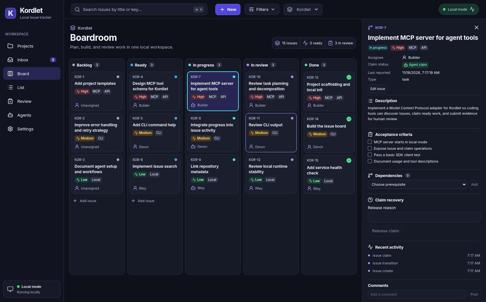

# Kordlet

Kordlet is a local issue tracker for developers who plan work, hand it to coding agents, and review the results.



## Run locally

Install Node 24 LTS and pnpm 10.32.1. You may need native build tools if a prebuilt SQLite binary is unavailable for your runtime.

```sh
npm install --global pnpm@10.32.1
pnpm install --frozen-lockfile
pnpm dev:web
```

Open the launch URL printed by the server to create an owner session. Create a project or select **Load demo project** to populate the sample workspace.

Use `pnpm dev:desktop` to start the Electron app. Desktop and web use the same data directory. Electron can attach to a headless service so agents keep working after the window closes.

## Connect a coding tool

With the service running, use the installed `kordlet` executable or invoke the local build with Node.

```sh
pnpm build
node dist/kordlet.mjs init KOR
node dist/kordlet.mjs bootstrap --tool codex --scope project
node dist/kordlet.mjs doctor
node dist/kordlet.mjs project list --json
```

Run `init` and `bootstrap` from the repository being tracked. If that differs from the Kordlet checkout, use the absolute path to the built CLI or install it on your PATH. Restart the coding tool after adding its project MCP configuration.

Kordlet stores issues, claims, and review history in local SQLite. It needs no cloud account or model API key. Claims are transactional and stay reserved until explicitly released, approved, canceled, or archived. Review evidence is attributed to the submitting credential.

## Reference

- [Install and develop](docs/development/setup.md)
- [User and agent guide](docs/user-guide.md)
- [REST, CLI and MCP operation reference](docs/api-reference.md)
- [REST authentication and wire behavior](docs/api.md)
- [Data locations, backup and restore](docs/data.md)
- [Architecture decision](docs/adr/0001-local-service.md)
- [Platform evidence and release checklist](docs/release.md)
- [Contributor instructions](AGENTS.md)
- [MIT license](LICENSE)
